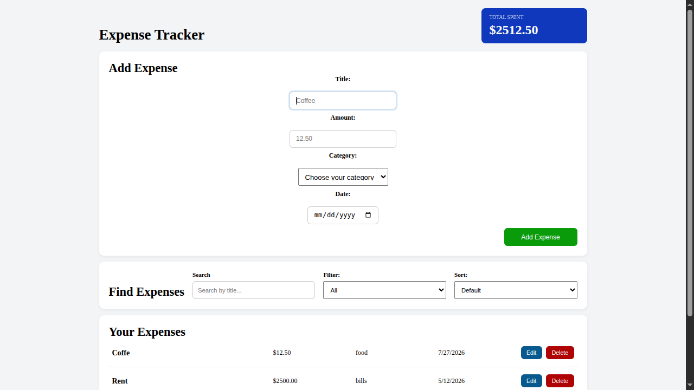

# Expense Tracker

A simple Expense Tracker application built with Vanilla JavaScript that allows users to manage personal expenses. Users can add, edit, delete, search, filter, and sort expenses, while keeping track of the total amount spent. All data is stored in the browser using Local Storage.

## Features

- Add new expenses
- Edit existing expenses
- Delete expenses
- Display total amount spent
- Search expenses by title
- Filter expenses by category
- Sort expenses by date
- Sort expenses by amount
- Sort expenses alphabetically
- Persist data using Local Storage
- Input validation
- Responsive layout

## Technologies

- HTML5
- CSS3
- JavaScript (ES6)
- Local Storage API
- Web Crypto API (`crypto.randomUUID()`)

## Project Structure

```
expense-tracker/
├── index.html
├── style.css
├── app.js
└── screenshots/
    └── expense-tracker.png
```

## Getting Started

1. Clone the repository.
2. Open `index.html` in your browser.

No additional dependencies or installation are required.

## What I Learned

This project helped me practice:

- CRUD operations
- DOM manipulation
- Event handling
- Dynamic UI rendering
- Local Storage
- Arrays and objects
- Array methods (`filter`, `find`, `findIndex`, `reduce`, `sort`)
- Search, filtering, and sorting
- Form validation
- JavaScript date handling
- Building reusable JavaScript functions

## Future Improvements

- Expense charts and analytics
- Monthly summaries
- Budget limits
- Export expenses as CSV
- Multiple currencies
- Dark mode

## Screenshot

